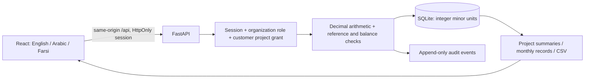

# Product direction and implementation boundaries

## First release

The selected priority is cost control, approvals, and stakeholder reporting for Gulf-region projects, initially in AED. The repository was empty except for its README. This implementation supplies a runnable application and database-backed workflows on which to develop the wider product.

The Python API owns authorization and all financial arithmetic. React presents the data, accepts decimal strings, and renders localized displays; JavaScript floating-point calculations never determine persisted financial values. SQLite is suitable for development and a single application instance. Each write opens an immediate transaction; linked balance validation and insertion happen in that same transaction. Foreign keys include tenant IDs for project/financial relationships, and all project-resource API queries are tenant-scoped.

## Request and data flow

Organizations are the security tenancy boundary; projects are separate accounting/reporting scopes within an organization. Staff roles cover the organization’s projects. Customers receive explicit project grants. Every member is a real user with their own account; membership addition does not send an invitation or email. The initial owner cannot approve their own financial submission and must add another authorized approver.

Session tokens contain 256 bits of randomness, are stored hashed in the database, and expire after 12 hours. Passwords use individually salted scrypt. Browser cookies are HttpOnly and SameSite=Lax; unsafe browser requests with an unapproved Origin are rejected. Set exact allowed origins and secure cookies behind HTTPS. No session tokens are placed in localStorage.

Audit records carry the actor, timestamp, entity, action, and JSON detail. Budget revisions preserve old and new values. SQLite triggers reject audit modification/deletion through ordinary SQL. These are application traceability controls; a database administrator can still alter the database or remove triggers. This is not an externally anchored, tamper-proof ledger.

## Stakeholder reporting

Current access supports CEO/CFO financial oversight, CTO technical oversight with financial read access, project manager and accountant operations, and customer project summaries. Views share an auditable source of approved records; there is no invented productivity, progress, or completion percentage.

Reports are on-demand in the browser, CSV downloads, or printable pages. **Scheduled email delivery, subscriptions, recipient preferences, and delivery tracking are not implemented.** A reporting service should generate frozen, versioned report snapshots with an explicit as-of timestamp, locale, audience, and permission scope, then enqueue delivery and record outcomes. Do not send stakeholder communications until recipients and delivery behavior have been configured and authorized.

## Production work before real financial use

1. Move to PostgreSQL with schema migrations, explicit decimal/minor-unit constraints, appropriate row locks, indexed reporting queries, pagination, and optional row-level security. Load-test tenant isolation and simultaneous approvals/payments.
2. Implement account invitation/verification, password recovery, MFA or organization SSO, session management/revocation, login throttling, and policy-controlled registration. Add membership revocation, role changes, account lifecycle, and project restrictions for internal staff when required.
3. Deploy behind HTTPS with secure cookies, exact CORS/Origin configuration, request/body limits, rate limiting, security headers, structured redacted logs, error monitoring, encrypted backups, and tested disaster recovery. Do not deploy the demo database or public sample accounts.
4. Model posted journals, chart of accounts, fiscal periods and locks, banking/reconciliation, credit notes, approved reversals, retention release, multi-line invoices, contractual variation orders, and recoverable/output VAT. Add documents, supplier/customer master data and identifiers, and controlled duplicate detection across projects. Obtain jurisdiction-specific accounting and tax review before statutory reporting.
5. Add multi-stage approval policies and thresholds, budget approval/version baselines, attachments and evidence, signed report snapshots, retention policy, and independent audit storage. Current financial submissions are immutable; the first release has no reversal/credit workflow for an incorrectly approved record.
6. Extend estimate-to-complete and cash-flow forecasting with remaining scope, contingencies, risk allowances, procurement schedules, exchange-rate snapshots, and scenario assumptions. Current exposure is actual invoices plus unbilled commitments only.

## Construction scheduling and site operations

The next operations module should use the same tenant/project boundaries:

- Hierarchical WBS and BOQ items linked to cost codes; activities, milestones, dependencies, calendars, baselines, planned/actual progress, and critical-path calculations.
- Daily site reports, labor and equipment hours, material receipts/usage, weather and work stoppages, photos and documents with versioned evidence.
- RFIs, submittals, inspections, QA/QC issues, safety observations, punch lists, and accountable owners/due dates.
- Change orders connecting scope/schedule impact with budget and commitment revisions.
- Role-specific reports: CEO portfolio risk, CFO cash/VAT/payables, CTO design/quality and technical risks, customer milestones/progress and agreed financial disclosures.

Document translation and user-entered content are separate from interface translation. Current supplier/project names and audit JSON field names remain their original content. CSV column labels are stable English for machine interoperability. Print summaries use the selected interface language. Calendar entry and stored dates remain ISO/Gregorian even when display is localized. Exchange conversion, Persian calendar input, multilingual project content, and translation review by native-speaking construction/accounting specialists remain future work.
